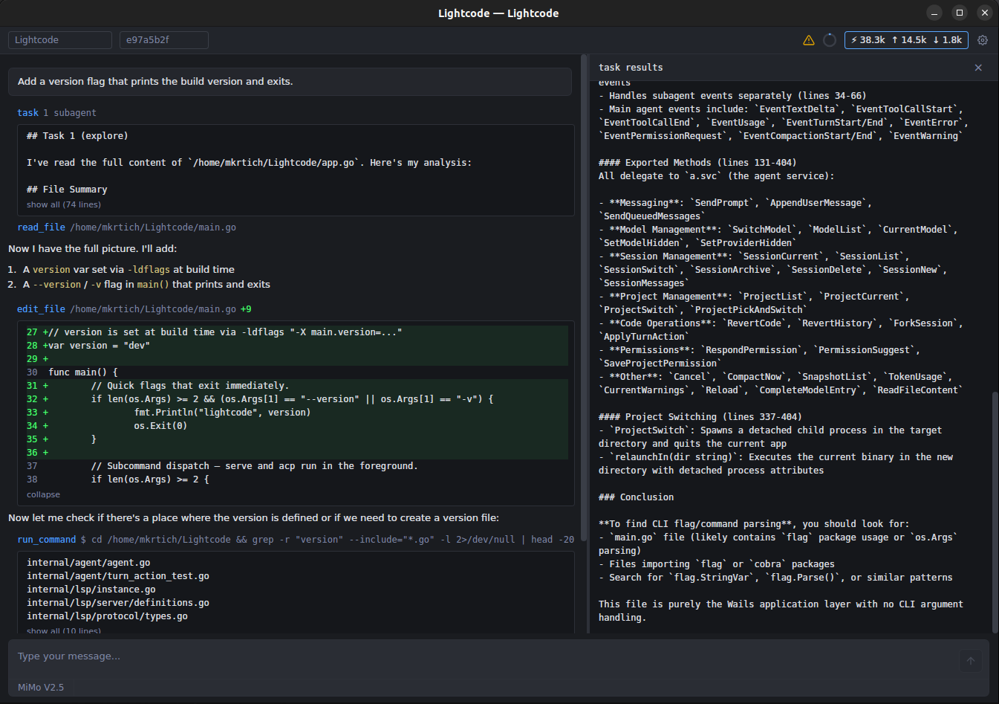

<h1 align="center">Lightcode</h1>

<p align="center">
  A coding agent that works with any OpenAI-compatible LLM provider.<br>
  Desktop app · Terminal CLI · ACP stdio adapter — one Go binary, three interfaces.
</p>

<p align="center">
  <a href="LICENSE"></a>
  <a href="https://goreportcard.com/report/github.com/MMinasyan/lightcode"></a>
</p>

<p align="center">
  
</p>

---

### Goals

| | |
|---|---|
| **Model freedom** | No vendor lock-in — any OpenAI-compatible endpoint |
| **Simplicity** | One binary, minimal moving parts, no external services |
| **Reliability** | Reversion, permissions, and snapshots that don't break |
| **Economics** | Bring your own providers, mix cloud and local |

---

### Features

**Providers** — Bundled metadata for OpenAI, OpenRouter, Alibaba/Qwen, Google Gemini, xAI/Grok, DeepSeek, Moonshot/Kimi, Mistral, MiniMax, Z.ai, Together, Groq, Fireworks, and Xiaomi MiMo. Add Ollama, llama.cpp, or any other OpenAI-compatible endpoint through config. Configure N providers simultaneously, switch mid-session.

Lightcode uses the OpenAI Chat Completions shape with streaming and tool calls. Provider compatibility still varies: some OpenAI-compatible models stream text correctly but do not reliably support streamed tool calls. Test a new provider/model with a real tool call before relying on it.

**Tools** — `read_file` · `write_file` · `edit_file` · `apply_patch` · `run_command` · `process` · `sleep` · `task`

**Snapshots** — File edits are captured copy-based before they happen, grouped per admitted operation. Revert code at any owned input or fork the conversation from it. No git dependency.

**Permissions** — One automatic allow/deny policy checked before every tool call: workspace file access, sensitive-file denials, and optional global/per-workspace rule lists. Nothing prompts.

**Context compaction** — Automatic single-request summarization over the frozen conversation when provider-reported usage would exceed the model's context window; `/compact` triggers it manually.

**Subagents** — Delegate a task to a background child session with its own context, tool surface, and model; concurrent child sessions are bounded by configuration.

---

### Quick start

#### Install

Linux amd64 is the first supported release target. Install the prebuilt binary from the latest GitHub Release:

```bash
curl -fsSL https://github.com/MMinasyan/lightcode/releases/latest/download/install.sh | sh
```

Run Lightcode:

```bash
lightcode
```

Linux amd64 on Debian/Ubuntu and Fedora is the first supported release target. macOS, Windows, Linux arm64, and package-manager formats are not part of this first release target.

#### Build from source

Source builds are for development. They require Go 1.26+, Node.js, [Wails v2](https://wails.io/docs/gettingstarted/installation), and WebKitGTK development headers.

```bash
# Debian / Ubuntu build dependencies
sudo apt update
sudo apt install libgtk-3-dev libwebkit2gtk-4.1-dev
```

```bash
wails build -tags webkit2_41
```

Binary: `build/bin/lightcode`

Optional install:

```bash
install -Dm755 build/bin/lightcode ~/.local/bin/lightcode
```

#### Configure

Lightcode ships with bundled provider metadata, but no credentials and no preset default model. On first run it creates `~/.lightcode/config.json` with an empty skeleton. API keys live in environment variables (or `~/.lightcode/.env`), referenced by name from provider `transport.api_key_env` fields:

```json
{
  "providers": {
    "openrouter": {
      "transport": {
        "headers": {
          "HTTP-Referer": "https://my-app.example"
        }
      },
      "models": {
        "z-ai/glm-5.1": {
          "name": "Z.ai GLM-5.1"
        }
      }
    },
    "ollama": {
      "transport": {
        "base_url": "http://localhost:11434/v1",
        "api_key_env": ""
      },
      "models": {
        "qwen3.6:27b": {
          "name": "Qwen3.6 27B",
          "context_window": 262144,
          "max_output_tokens": 65536
        }
      }
    }
  }
}
```

Put model selections in `~/.lightcode/agents.json`:

```json
{
  "primary": {
    "model": "openrouter/z-ai/glm-5.1"
  }
}
```

Example key setup:

```bash
mkdir -p ~/.lightcode
printf 'OPENROUTER_API_KEY=...\n' >> ~/.lightcode/.env
```

Shell-exported environment variables take precedence over values in `~/.lightcode/.env`.

#### Permissions

Every tool call is checked before execution against one automatic policy and never prompts. The built-in policy allows file reads and writes inside the workspace and denies sensitive file basenames (`.env`, private keys, credential files) even there. Its target permissions are scoped: `command.run`, `child.launch`, and `process.own` allow any target, and `sleep` only its fixed target; anything undeclared is denied. Child sessions are gated by the same policy. Pair targets are canonical: a resolved file path for the file pairs, one parsed shell segment (or the complete normalized command) for `command.run`, `*` for `sleep`, the resolved Agent-type identity for `child.launch`, and `<session-id>/<job-id>` for `process.own` read/kill (or `*` for its list action).

Optional rule lists refine that policy: global rules live in the `permissions` member of `~/.lightcode/config.json`, per-workspace rules in `~/.lightcode/projects/p-<full SHA-256 of the cleaned absolute workspace path>/permissions.json` (that directory name is a storage key for the permission file, not a durable project record):

```json
{
  "permissions": {
    "rules": [
      { "permission": "command.run", "target": "git *", "access": "allow" },
      { "permission": "file.write", "target": "**/generated/**", "access": "deny" }
    ],
    "default": "deny"
  }
}
```

Rule targets are globs matched against the pair's canonical target — for example a resolved file path, a parsed `command.run` segment or complete command text, an Agent-type identity, a `<session-id>/<job-id>` job reference, or the fixed `*` (the rules above are illustrative). The last matching rule at a level wins, the workspace level decides before the global level, and a level's `default` applies when no rule matches. Permission names are `file.read`, `file.write`, `command.run`, `sleep`, `child.launch`, and `process.own`. A malformed block discards both user levels for that resolution, leaving the built-in policy.

#### Run

Run Lightcode from the workspace directory you want it to work on:

```bash
lightcode                       # Desktop GUI
lightcode cli                   # Terminal REPL
lightcode acp                   # JSON-RPC over stdio
```

All three clients share one managed Runtime owner process. The first client starts it
(`lightcode runtime --data-dir ~/.lightcode --config ~/.lightcode/config.json` under the hood) and
later clients attach to the same owner. SIGINT or SIGTERM on the Runtime process is the managed
shutdown — closing the last client is not a shutdown. `lightcode upgrade` replaces the executable,
not the running Runtime; restart the Runtime to apply backend changes.

Useful CLI commands:

- `/help` — command reference
- `/new`, `/resume`, `/session` — start, resume, or switch sessions
- `/model`, `/agent` — switch model or agent type
- `/project` — switch workspace
- `/revert`, `/fork` — revert code at a turn, or fork from it
- `/context`, `/compact`, `/warnings` — token usage, manual compaction, current warnings
- `/children`, `/stop`, `/runtime`, `/copy`, `/clear`, `/exit`

ACP clients drive Lightcode over newline-delimited JSON-RPC on stdio.

#### Commands

Beyond the run modes above, the binary ships utility commands: `runtime` (run the shared Runtime
owner directly; clients start it automatically), `version`, `doctor` (offline install/config
diagnostics), `upgrade` (self-update; verifies the release's SHA-256 checksum before installing),
`uninstall`, `completion`, `models`, and `config`. Run `lightcode help` for the full reference.

#### Data locations

- `~/.lightcode/config.json` — user config: providers, session policy, plugin sections, and global permission rules
- `~/.lightcode/agents.json` — agent types and their model selections
- `~/.lightcode/.env` — local API keys
- `~/.lightcode/lightcode.db` — durable session state (SQLite), owned by the Runtime
- `~/.lightcode/runtime.json` — live Runtime owner record (present only while the owner runs)
- `~/.lightcode/code/<session-id>/` — per-session code snapshots and command output (internal adjunct)
- `~/.lightcode/cache/discovery/` — provider discovery responses
- `~/.lightcode/debug/wire/` — raw request and stream dumps when `LIGHTCODE_DEBUG_WIRE=1`

Filesystem sessions created before the SQLite store stay under `~/.lightcode/projects/`: they are
not migrated, not loaded, and not deleted. Their code snapshots remain reachable through the
Runtime's retained snapshot operations, addressed explicitly by workspace and old session id.

---

### License

[MIT](LICENSE)
